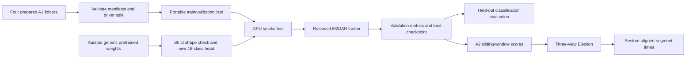

# M2DAR training package for the prepared AI City 2024 data

The training code is prepared in this folder. **Training has not started.** The next operational step is connecting the NVIDIA GPU server, auditing a generic pretrained checkpoint, and passing the GPU smoke test.

This is an adaptation of the **released M2DAR MViTv2-S configuration**, pinned to [commit 8fc6a3f](https://github.com/PurdueDigitalTwin/M2DAR/tree/8fc6a3f76fc47207c4fa072dff7259f0debb5472). The paper describes a B variant while the released configuration is named S; do not describe this package as an exact reproduction of the paper's B model. The pretrained checkpoint and its training history are still to be verified.

## Data used

| Split | Drivers | Three-camera action groups | Individual camera clips |
|---|---:|---:|---:|
| Training | 32 | 775 | 2,325 |
| Held-out validation | 8 | 152 | 456 |
| Total A1 | 40 | 927 | 2,781 |

All 16 zero-based action classes are present in both supervised splits. The existing driver split is preserved; A2 drivers are excluded. Media is referenced in place, with no duplicate video copies. The preparation scripts check all file paths and expected byte sizes against the existing decode audit; they do not re-decode every video or claim cryptographic verification of every media byte.

Training uses each camera clip as an individual sample: `[batch, 3 RGB channels, 16 frames, 448, 448]`. The three camera views are **not** passed as an extra model dimension. The released architecture shares one classifier across cameras and combines predictions later with Election.

There are 96 short action groups with fewer than 64 observed frames. The source sampler repeats valid boundary frames when needed. Existing annotations, exclusions, synchronization estimates, and edge margins are retained. Synchronization is a conservative motion-derived estimate, not hardware-clock ground truth.

## Flow



## Files to transfer to the server

Keep the following sibling directory layout. `DATA_ROOT` is their parent directory, for example `/data/aicity2024`.

```text
/data/aicity2024/
  M2DAR_preprocessed/       # combined manifests and original split metadata
  A1_preprocessed/clips/
  A1_2_preprocessed/clips/
  A1_3_preprocessed/clips/
  A1_4_preprocessed/clips/
  A2_preprocessed/          # only needed for later aligned A2 inference
  A2/SET-A2/               # only needed for later original-stream A2 inference
```

Transfer this training-code folder separately, for example to `/workspace/m2dar-training`. Exclude `.validation-tools`, `__pycache__`, and the local `prepared/` bundles from transfer. The local bundles point to `F:`; regenerate server bundles below. `vendor/M2DAR` and `source_lock.json` must be included. Raw A1 videos and the original annotation folders are not required to train from the prepared clips. Keep their existing local copies as provenance.

## Server setup and training

Run commands from the transferred training-code folder. Commands are separate stages so that setup, checking, and training remain identifiable.

### 1. Environment

Follow [environment/README.md](environment/README.md). The candidate setup targets Linux x86_64, Python 3.10 or 3.11, and a compatible NVIDIA GPU. The installer now defaults to CUDA 11.8 wheels following the reported driver 515.76 on `ctl`; actual GPU execution is still pending. For the available `python-3.11.4` module, load that module and replace `python3.10` below with `python3.11`.

```bash
cd /workspace/m2dar-training
python3.10 -m venv .venv
source .venv/bin/activate
bash environment/setup_linux.sh
python -m unittest discover -s tests -v
```

### 2. Build the server's data/config bundle

```bash
python scripts/prepare_data.py --data-root /data/aicity2024 --out prepared/server
python scripts/preflight.py --bundle prepared/server --out checks/server_data.json
```

The default is the released 448-pixel, 16x4, batch-3, FP32, AdamW baseline: 200 epochs, base learning rate `5e-6`, 30 warm-up epochs, cosine schedule, dropout 0.5, no horizontal flips. Validation and periodic checkpoint saving occur every 10 epochs. The original source saved every 40 epochs; matching checkpoint and validation periods permits reliable restart and model comparison. All effective settings are saved in the run.

If the GPU smoke test runs out of memory, create a **new** bundle with `--batch-size 1 --amp` and rerun preflight. This changes the optimization protocol and must be reported. Resolution and learning rate are not automatically changed. Fresh runs now retain the latest two periodic model/optimizer checkpoints plus the best inference model, rather than accumulating 20 periodic files. A third periodic file exists temporarily during saving/validation. The policy is recorded in `run.json` and can be changed for a fresh run with `--keep-last-checkpoints`. Actual checkpoint sizes will be measured on the server.

### 3. Audit and prepare initial weights

Use a generic pretrained initializer whose training history excludes these held-out AICity/SynDD2 drivers. The repository's AICity-finetuned 200-epoch model is not a valid initializer for an independent held-out-driver experiment. Checkpoint names alone do not establish provenance.

The [source README](https://github.com/PurdueDigitalTwin/M2DAR/blob/8fc6a3f76fc47207c4fa072dff7259f0debb5472/README.md) links a generic pretrained model and a separate AICity-finetuned model. No weights have been downloaded or audited here. Copy `configs/initializer_provenance.example.json` to a completed JSON file with the source, training datasets, supporting evidence, and SHA256 of the actual generic checkpoint.

```bash
sha256sum /models/MViTv2_S_16x4_pretrained.pyth
python scripts/prepare_initializer.py \
  --bundle prepared/server \
  --checkpoint /models/MViTv2_S_16x4_pretrained.pyth \
  --provenance /models/initializer_provenance.json \
  --output checkpoints/generic_initializer.pyth
```

This discards the generic classification head, checks every backbone tensor, and writes a normalized initializer. The trainer creates a new 16-class head. If only the square spatial position grid differs because pretraining used a lower resolution, review that difference and rerun with `--resize-spatial-position`; this records explicit bicubic interpolation. Other architectural mismatches fail instead of silently loading a partial model. The utility accepts a PySlowFast `model_state` checkpoint, with an optional `module.` prefix, and safely loads tensor/primitive checkpoints with `weights_only=True`.

### 4. Run the GPU smoke test

```bash
python scripts/preflight.py --bundle prepared/server \
  --checkpoint checkpoints/generic_initializer.pyth \
  --gpu-smoke --out checks/gpu_smoke.json
```

The test decodes real clips, checks `[B,3,16,448,448]` inputs and 16-class outputs, verifies finite loss and gradients, performs one disposable optimizer step to allocate optimizer state, checks softmax evaluation, and compares repeated validation samples. It saves no trained weights. The report records GPU memory and `pip freeze`. A matching passed report is required before a fresh training run.

AMP may overflow during its initial loss-scale calibration. The smoke test now permits bounded GradScaler backoff on the same batch/dropout realization, records every attempt, and requires a finite-gradient optimizer update plus finite resulting parameters. Persistent bad gradients at scale 1, non-finite losses, or exhaustion of the retry budget still fail and write diagnostics. The actual trainer already uses GradScaler's skip/backoff behavior; its optimization code is unchanged by this smoke-test correction.

For a memory-constrained experiment, create a separate bundle with `--batch-size 1 --workers 2 --amp`. On the reported 24 GiB RTX 3090, `--gpu-memory-fraction 0.20` limits PyTorch's allocator to about 4.8 GiB and checks that another 1 GiB is free before proceeding. CUDA context/library memory is additional; this is not a hard limit on total process VRAM or an exclusive reservation. Use the same flag for smoke testing, training and resume. Record batch 1 and mixed precision as deviations from the released batch-3 FP32 baseline. If the bounded smoke test runs out of memory, stop and use a GPU with more available memory rather than automatically raising the limit on the occupied GPU.

### 5. Train

```bash
python scripts/train.py --bundle prepared/server \
  --run runs/m2dar_s_40drivers_seed42 \
  --initializer checkpoints/generic_initializer.pyth \
  --preflight-report checks/gpu_smoke.json
```

Add `--dry-run` to check the launch without starting the trainer. A fresh run requires an empty output folder. The script invokes the vendored `tools/train_net.py`, preserving the released model and optimizer implementation.

Outputs include `resolved.yaml`, `run.json`, `metrics.jsonl`, per-epoch metrics, TensorBoard logs, periodic optimizer checkpoints, and `best.pyth`. The best checkpoint is selected by **validation macro-F1** across the 456 camera clips, with earlier checkpoints retained on ties. It is for evaluation/inference only. This is validation-based model selection, not an independent test-set result.

For storage planning, the prepared A1 media is 4.846 GB (4.51 GiB). Budget approximately 7–10 GB for the Python/CUDA environment and 1–3 GB for initial weights, two periodic checkpoints, the best model, and logs until actual sizes are known. Plan roughly 15–20 GB of steady disk use and additional temporary space for downloads or archives. This is an estimate, not a measurement of the server's installed environment. Existing unrelated files and other users' consumption are outside that budget. Keep A2 and raw A1 off the server for initial training. Mini-batches reduce GPU memory use; all prepared training clips remain available for shuffled training each epoch. No image-frame dataset is written to disk.

### 6. Resume an interrupted run

```bash
python scripts/train.py --bundle prepared/server \
  --run runs/m2dar_s_40drivers_seed42 \
  --resume runs/m2dar_s_40drivers_seed42/checkpoints/checkpoint_epoch_00010.pyth
```

Use the actual latest periodic checkpoint filename in that directory. `best.pyth` omits optimizer state and cannot resume training. The launcher checks split, code/config integrity, architecture, optimizer/epoch availability, and checkpoint membership in the run. Resume occurs at the next saved epoch boundary, not mid-epoch. Epoch reseeding aids reproducibility under the same environment; bit-identical behavior across hardware/library versions is not promised.

## Evaluate the held-out A1 drivers

```bash
python scripts/evaluate.py --bundle prepared/server \
  --checkpoint runs/m2dar_s_40drivers_seed42/best.pyth \
  --out runs/m2dar_s_40drivers_seed42/evaluation
```

The outputs contain top-1/top-5 accuracy, macro-F1, balanced accuracy, per-class precision/recall/F1, a confusion matrix, and predictions for every validation clip. Per-camera results and equal-weight three-camera **classification** averaging are also reported. The averaging diagnostic is distinct from temporal Election. These scores evaluate trimmed action classification; they are not the AI City temporal localization score.

## A2 inference after training

A2 is unlabelled inference data, not a supervised validation set. It is excluded from training and checkpoint selection. No local A2 accuracy, mAP, or official challenge score can be computed without its ground truth.

The aligned route covers **72.8156%** of dashboard reference time: 415 aligned groups / 1,245 clips, across 30 recordings. Unsupported intervals remain unknown; they are not labelled normal and are not silently filled. The restored output is a set of candidates, not a complete official submission or full-coverage evaluation.

```bash
python scripts/prepare_a2.py --data-root /data/aicity2024 \
  --mode aligned --out prepared/a2_aligned
python scripts/infer_a2.py --bundle prepared/server --a2-bundle prepared/a2_aligned \
  --checkpoint runs/m2dar_s_40drivers_seed42/best.pyth \
  --out runs/m2dar_s_40drivers_seed42/a2_aligned
```

The code runs the released 64-frame sliding windows with stride 16, saves camera probabilities, applies Election, and restores segment times to the original dashboard timeline. The released class weights and thresholds are retained as an uncalibrated baseline; they were not tuned for the new dataset. Overlapping same-class segment candidates merge, while unknown gaps remain. Election chooses one candidate per class **within each segment**, so this partial-segment adaptation is not identical to one full-recording Election pass. `restored_candidates.jsonl` preserves fractional offsets and may have multiple candidates per class; a full official submission needs an explicit coverage/final-selection protocol.

For a full-original-stream baseline, build a second A2 bundle with `--mode original`, then use that bundle with `infer_a2.py`. It requires `A2/SET-A2`, processes all 90 original videos, and retains their original camera timing differences. Do not describe that route as synchronized. A coverage-aware comparison/fallback strategy is future research work, not silently part of this training package.

## Recorded source adaptations

Inspect [patches/prepared-data.patch](patches/prepared-data.patch) and [source_lock.json](source_lock.json). The upstream archive and all source files are fingerprinted.

- Aicity validation uses one center temporal window, deterministic center crop, and fixed resize. Training sampling stays random. Decoder failure raises with the clip path instead of replacing the sample.
- The detection-only Detectron2 import is deferred until its ROI head is actually constructed.
- The multigrid helper's version comparison is corrected for Torch 2.x; its original condition incorrectly tried importing the removed `torch._six` module under Torch 2.4.
- Python, NumPy and Torch seeds are set; epoch-boundary seeding is added for resumes. The launcher disables TF32 and cuDNN benchmarking and enables deterministic cuDNN selection.
- Checkpoint loading explicitly uses `weights_only=True`; the wrappers audit initialization and enforce complete backbone/full-model shape compatibility.
- A validation hook records macro-F1/per-class metrics and the best inference model. The stock console's `mAP/top5-err` label is inherited terminology; use the explicit metrics JSON for classification results.
- Pooled attention uses PyTorch scaled-dot-product attention with fused CUDA backends, instead of explicitly materializing its large score matrix. Pooling, scale, query residuals, projections and learned parameter keys are preserved. GPU math fallback is disabled to avoid recreating the memory peak. Floating-point results may differ slightly by kernel. CPU output/gradient equivalence tests must pass in the server environment, followed by the full GPU smoke test; local checks without Torch skip those numerical tests.

Local checks are in `checks/`. GPU execution and pretrained-weight compatibility remain pending until the server and actual initializer are available. The model architecture, train/validation split, and preprocessing provenance are kept explicit so experiments can be reported accurately.
